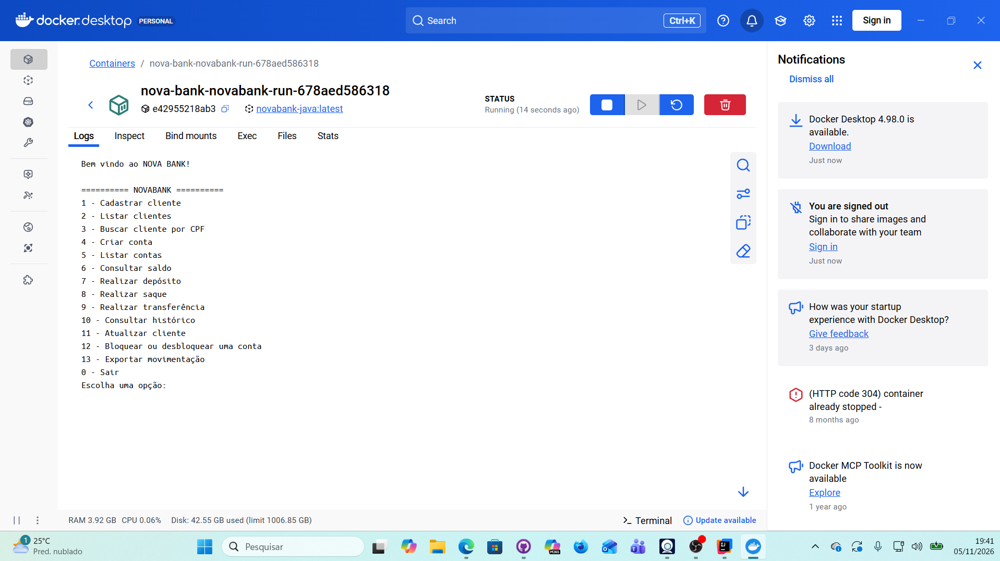
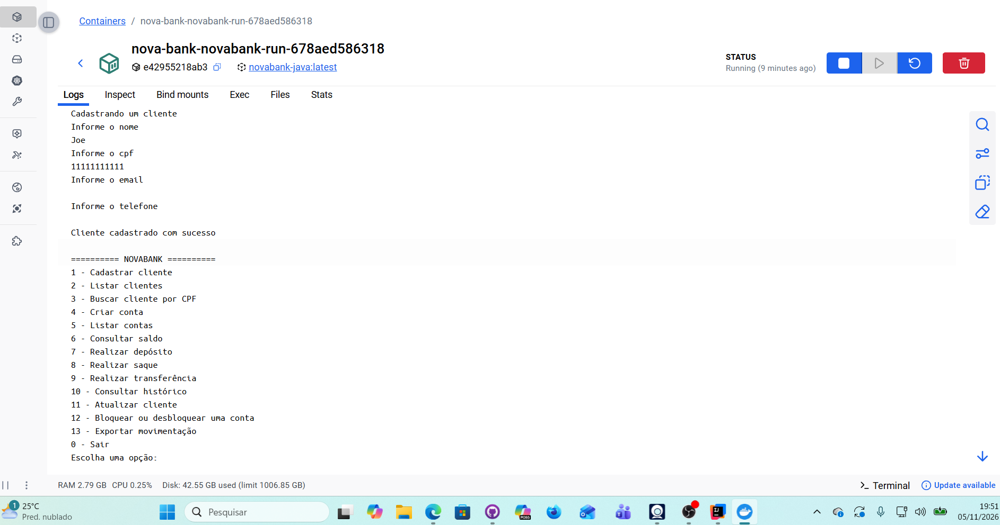
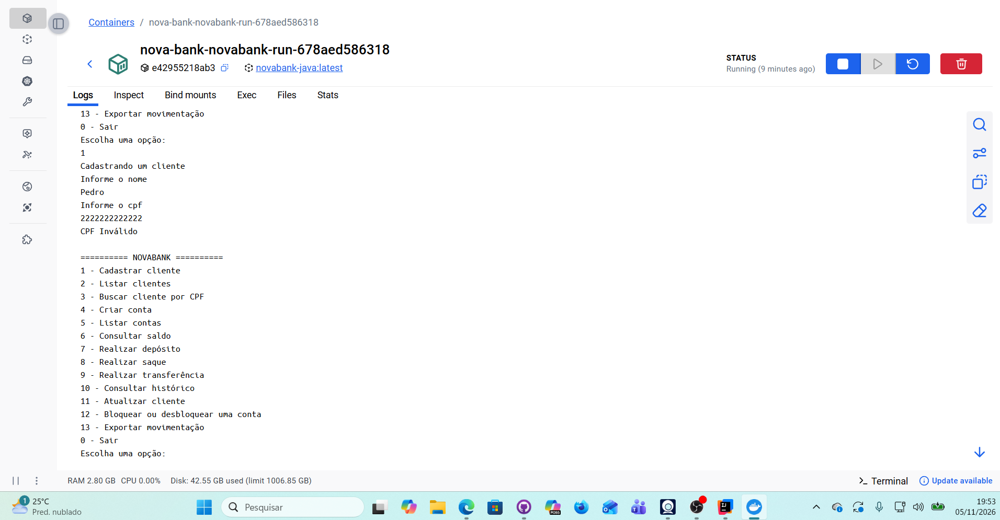
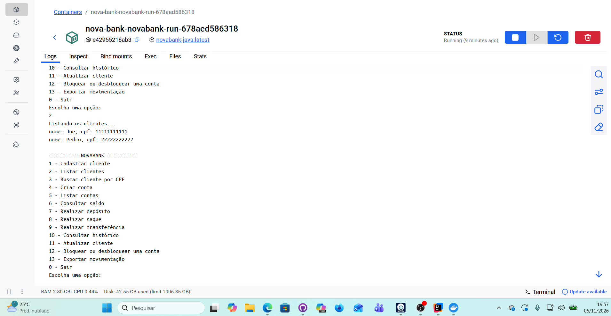
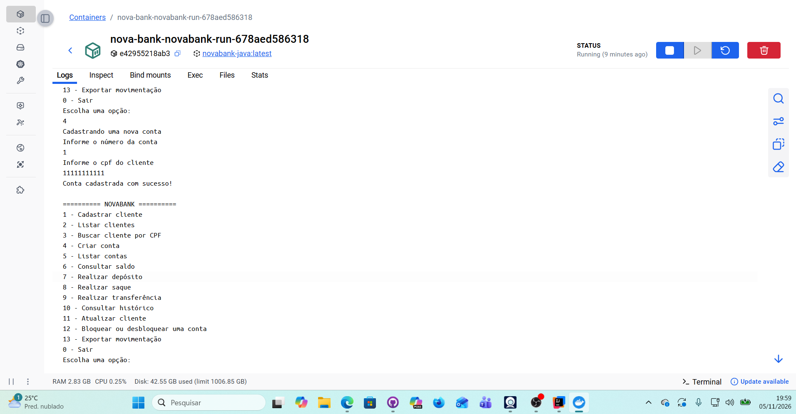
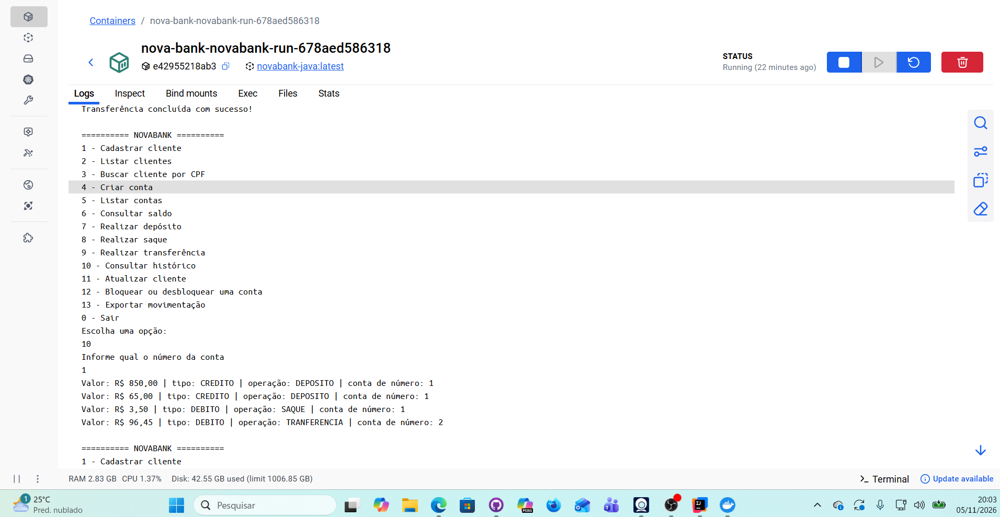

## Bem vindo ao Nova Bank

### Comandos para executar a aplicação no Docker
- `docker compose build`
- `docker compose run --rm novabank`

  > Versão do Java: 21

### Aplicação desenvolvida ao vivo (em lives no YouTube)
- Playlist: [Desafio de Java - NTT DATA](https://studio.youtube.com/playlist/PLZN0s4Cu1PYs/videos)
- Minutagem dos testes da aplicação: a partir do minuto 1:30:00

### Evidências da aplicação em execução

