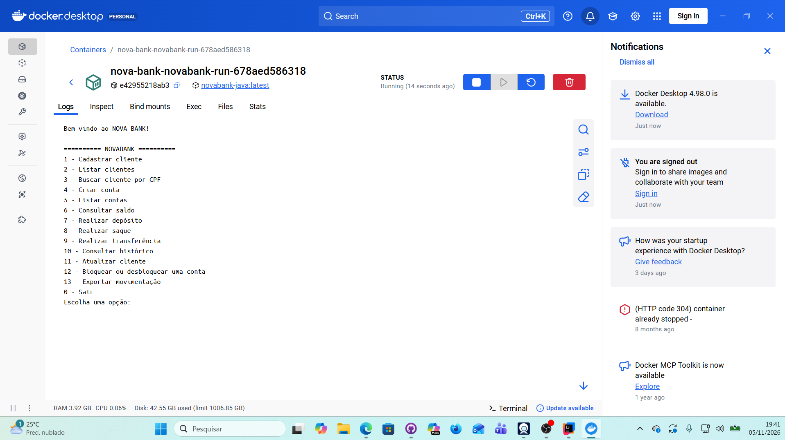
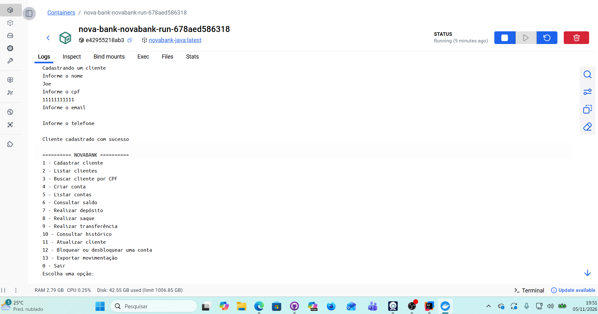
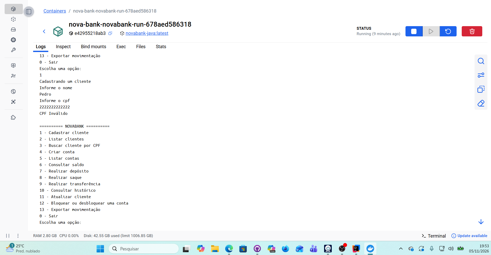
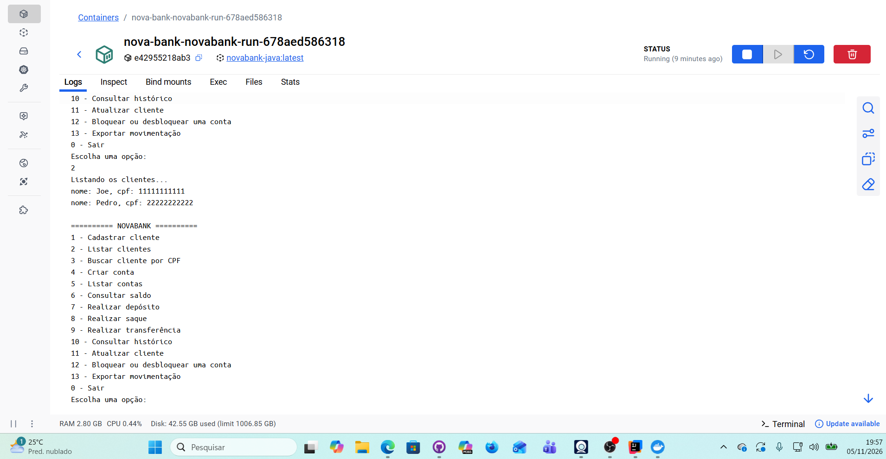
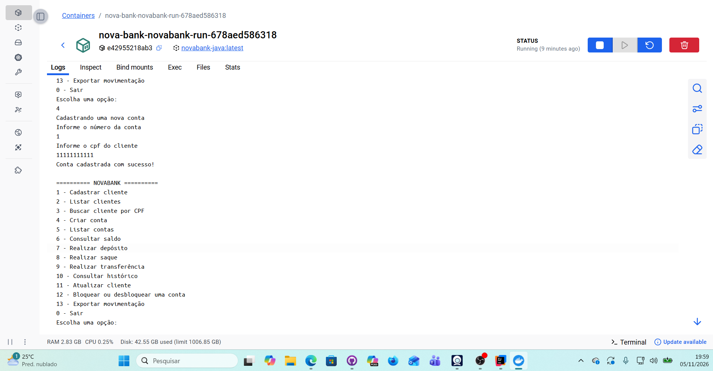
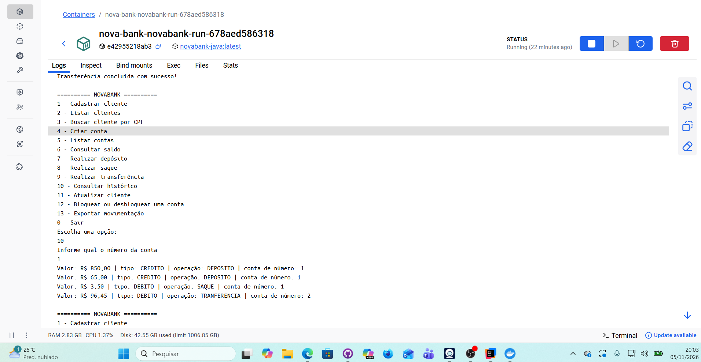

## Bem vindo ao Nova Bank

### Comandos para executar a aplicação no Docker
- `docker compose build`
- `docker compose run --rm novabank`

  > Versão do Java: 21

### Aplicação desenvolvida ao vivo (em lives no YouTube)
- Playlist: [Desafio de Java - NTT DATA](https://studio.youtube.com/playlist/PLZN0s4Cu1PYs/videos)
- Vídeo dos testes: [Desafio de Java - testes](https://www.youtube.com/live/6hBt59oJ3UU)
### Testes da aplicação
0. Sair
1. Cadastrar cliente: 1:57:00
2. Listar clientes: 1:58:25
3. Buscar cliente por CPF: 1:58:30
4. Criar conta: 1:58:25
5. Listar contas: 2:00:12
6. Consultar saldo: 2:00:25
7. Realizar depósito: 2:00:30
8. Realizar saque: 2:01:05
9. Realizar transferência: 2:01:25
10. Consultar histórico: 2:01:43
11. Atualizar cliente: 2:03:56
12. Bloquear ou desbloquear uma conta: 2:05:40
13. Exportar movimentação
    1. Testes: 2:08:31
    2. Validação dos arquivos no container: 2:16:46
    3. Bug encontrado: 2:22:20
    4. Correção: 2:26:25
    5. Reteste: 2:32:20
    6. Validação dos arquivos no container: 2:32:30

### Evidências da aplicação em execução

